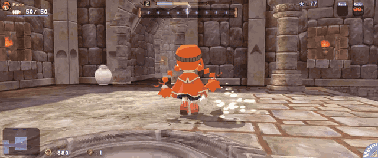

# Gurumin Enhanced Rendering

[](https://github.com/ObeseCatLord/gurumin-enhanced-rendering/blob/main/docs/media/showcase.mp4)

A rendering and camera mod for **Gurumin: A Monstrous Adventure**, Steam version
1.4. I don't know if this works on the GOG version.

[Download](https://github.com/ObeseCatLord/gurumin-enhanced-rendering/releases/latest)

Also Consider:
These mods add the PSP only outfits to the PC version

[PSP Outfits English Voices](https://www.mediafire.com/file/njpt5i7l36fwwnp/Gurumin_PSP_Outfits_ENG.zip/file)

[PSP Outfits Japanese Voices](https://www.mediafire.com/file/cfdv3526znwlg8t/Gurumin_PSP_Outfits_JP.zip/file)

I recommend mods from [Tenome](https://github.com/Tenome/Gurumin-Modding) which include script fixes, Japanese voice acting, and other enhancements

## Features

- Actual higher internal rendering resolution, including 3440×1440 and other
  ultrawide modes, with Hor+ framing at a constant vertical field of view.
- Proportional HUD
- Smooth render interpolation for characters, rigid attachments, camera, rhythm
  track, effects and shadows while gameplay keeps its original 30 Hz simulation.
- High framerate support, plus native VSync
- Right stick free camera as an option. The game isn't made with it in mind, can look weird in town
- Higher Resolution Shadows
- FXAA
- **Optional 6DoF VR (OpenXR)**: third-person VR with a camera rig that follows
  Parin, life-size or diorama (tabletop) scale, gamepad or VR controllers.
  Works on Windows and on Linux through Proton with Monado/WiVRn or SteamVR.

## Install — copy into the game folder

Extract the ZIP and copy the contents of its single release folder into the
Gurumin game directory, next to `gurumin.exe`. Windows needs no installer.
Updates preserve your existing settings. The same ZIP works on Windows and Linux.

You can use the optional installer to automatically find and install the mod for you, if you are too lazy to drag & drop it
On Linux/Steam Deck, set this per-game Steam launch option once:

```text
WINEDLLOVERRIDES="d3d9=n,b" %command%
```

The optional Linux installer can do this automatically. Close Steam while it
updates that setting. If you already use other launch options, the installer
preserves supported wrappers, arguments and other DLL overrides.

Linux startup was tested with **GE-Proton10-34**. If Proton Experimental exits
before the launcher appears, select GE-Proton10-34 in Steam → Properties →
Compatibility. Install that compatibility tool first if it is not available.
The installer sets launch options; it does not select or install Proton.

If the separate PSP outfits mod is also installed, retain both overrides:

```text
WINEDLLOVERRIDES="d3d9=n,b;dinput8=n,b" %command%
```

### Configure the game

Start Gurumin normally through Steam. Open **Graphics / Audio** in the game's
settings window and choose your resolution, cap and camera settings. **More
settings** provides shadow resolution, AA and texture filtering. Choose **Start
Game** or **Close** to save; Cancel/Escape discard changes. Restart to apply.

The original **Filtering** dropdown includes anisotropic levels through **16×**.
Requests are limited to the GPU's supported maximum. Set **World textures** to
**Native filtering** to use it; **Nearest (pixelated)** overrides filtering for
the selected texture category.


## VR mode

Tick **VR (OpenXR)** in the launcher's *Display / Camera / VR* group, or start the
game with `-vr` (e.g. in Steam's launch options after `%command%`) to use VR for
that launch only. Pick **Life size scale** (stand in the world behind Parin) or
**Diorama scale** (the level as a tabletop model in front of you). VR is off by
default and nothing VR-related runs when it is off.

Start your OpenXR runtime (SteamVR, or Monado/WiVRn e.g. via Envision) before or
after the game; the mod launches its small OpenXR host
(`GuruminVR\gurumin_vr_host.exe`) and reconnects if the runtime starts later.

| Action | Gamepad | VR controllers |
|---|---|---|
| Move Parin (relative to where you look) | Left stick | Left stick |
| Turn the camera rig around Parin | Right stick left/right | Right stick left/right |
| Raise / lower the rig | Right stick up/down | Right stick up/down |
| Recenter | Click both sticks | Click both sticks |
| Game buttons | As configured in the launcher | A/B/X/Y, grips = LB/RB, triggers = LT/RT, left menu = Start, right menu = Back |

The HUD floats in front of you and follows your head with a soft, trailing lag;
menus, the title and loading screens appear on a larger virtual screen.
Both eyes are rendered in a single pass of the game's scene. Advanced options
(scale, rig distance/height, snap turning, render scale, HUD size) are listed in
`GuruminModern.ini`.

Linux / Proton notes:
- Use DXVK (the Proton default); Proton's OpenXR bridge needs it.
- For Monado/WiVRn add `PRESSURE_VESSEL_IMPORT_OPENXR_1_RUNTIMES=1` before
  `%command%`, e.g.
  `PRESSURE_VESSEL_IMPORT_OPENXR_1_RUNTIMES=1 WINEDLLOVERRIDES="d3d9=n,b" %command%`.
- Eye images go to the runtime without a CPU copy under Proton. Native Windows
  D3D9 cannot share them, so Windows uses a slower CPU copy (lower the
  per-eye `VRRenderScale` if frame rate suffers).

Screen fades and the iris transition darken your whole view in both eyes;
cinematic letterbox bars are left out in VR. The camera rig never moves on its
own to avoid walls, so in tight rooms you may see through a wall until you turn
the rig with the right stick.

VR limitations: water reflections are rendered from the flat camera.

## Compatibility and limitations

- This release targets Steam 1.4/build 603361, not every retail executable.
- High resolutions are subject to GPU texture limits and memory availability;
  unsupported output/resource requests fall back to desktop windowed output.
- FXAA is spatial AA. HUD text and menus are outside the gameplay filter;
  world-space markers already rendered into the scene are included. Unsupported
  native effect paths retain their native shader and sampling behavior.
- **Out of town only** is enabled by default. With Free camera enabled, this
  keeps the native camera in the main town outdoors; rooms, shops and outdoor
  dungeons still allow freecam. Turn it off to orbit around the town camera
  anchors too. Movement follows the rotated view while town freecam is active.
  **Free camera** itself remains off by default; **Invert X** remains on.
- The game remains a 30 Hz simulation; interpolation smooths rendering rather
  than converting its entire gameplay and animation system to a new tick rate.
- Runtime validation included 3440×1440 at approximately 175 FPS with 30 Hz gameplay,
  Steam Input orbit, equipment rewards, menus, shadows and the outdoor Manual.
  Recent cinematic/attachment corrections also have isolated x86 regression tests;
  report remaining scene-specific issues with a reproduction and screenshot.

## Build and tests

Build the x86 D3D9 proxy using MinGW-w64 GCC/G++:

```sh
./build.sh
python3 -m unittest discover -s tests -p '*_test.py'
python3 tools/package.py
```

The packager builds the x64 Windows launcher and downloads the official Python
embeddable runtime with a pinned SHA-256. It creates one Windows/Linux ZIP and
`SHA256SUMS` under `release/`. Existing precompiled, mod-owned FXAA shader bytecode
is checked in; `tools/compile_edge_aa.sh` rebuilds it in an explicit Wine prefix.

Stock-executable integration tests require your own game files:

```sh
GURUMIN_STOCK_DIR='/path/to/Gurumin A Monstrous Adventure' python3 tests/install_test.py
```

The fixture accepts stock executables or verified `.guruminfix-original` sidecars.
It creates temporary copies and never changes the live installation. The C++
portable tests are under `tests/`; `native_render_test.cpp` exercises the actual
proxy with a fake game image under Windows or Wine. See `SENIOR_REVIEW.md` for
review dispositions and `MODLOG.md` for reverse-engineering and validation notes.

## Credits and license

Created by **ObeseCatLord**.
Implementation and reverse-engineering assistance: OpenAI Codex; design reviews: Astra.
Original mod code is MIT licensed. MinHook, NVIDIA FXAA and the Khronos OpenXR
loader/headers retain their respective licenses; the bundled Windows Python runtime retains the PSF license. See
[THIRD_PARTY_NOTICES.md](THIRD_PARTY_NOTICES.md). No generated art/audio is used.
Gurumin and its game assets belong to their respective owners.
